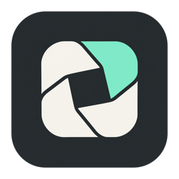
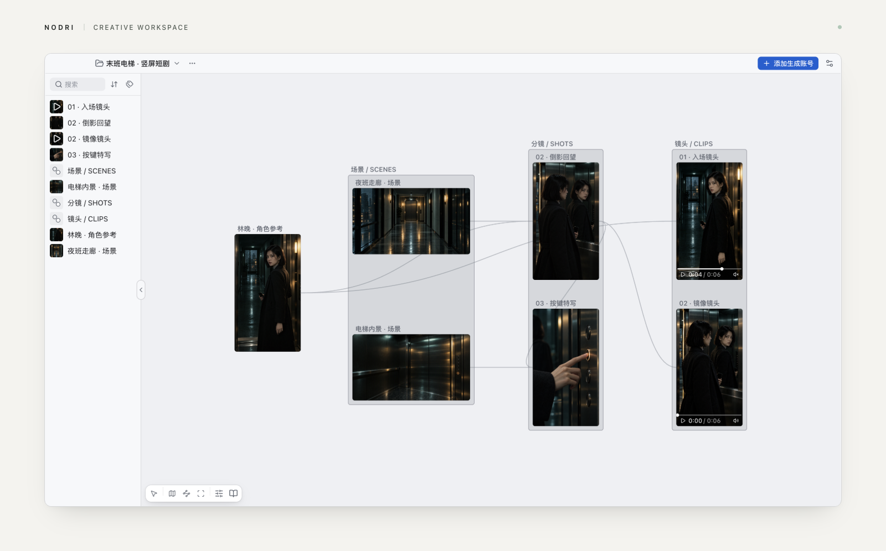
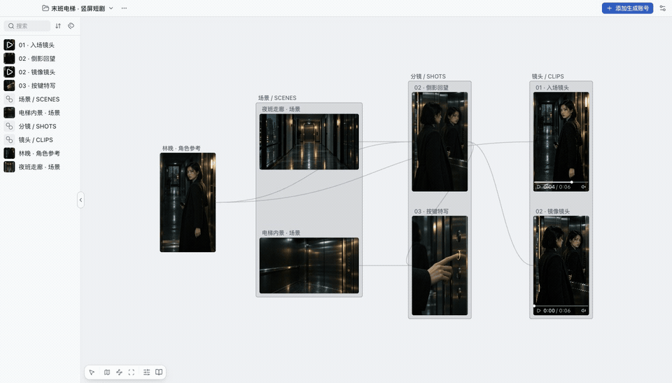
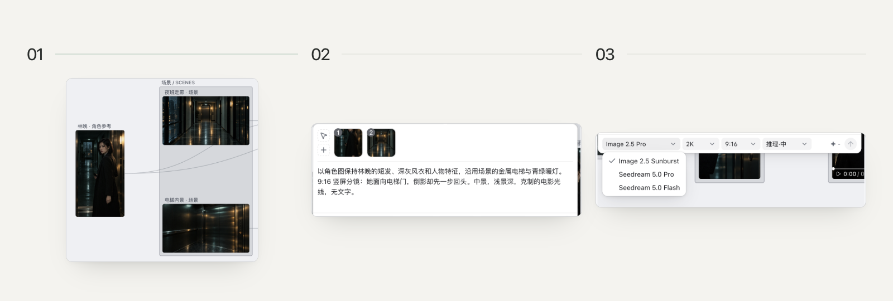
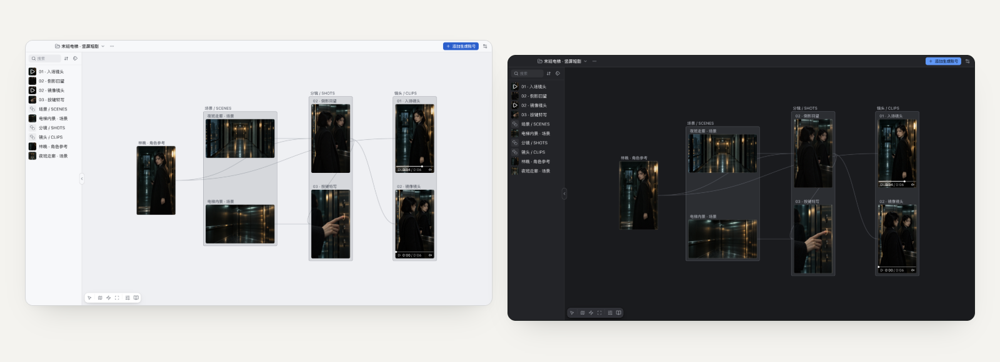

  

<h1 align="center">Nodri — AI Image &amp; Video Canvas</h1>

<strong>A local creative canvas for Jimeng, Xiaoyunque and LibTV.</strong> 
支持即梦、小云雀的 AI 图像与视频创作画布。

English · <a href="./README.zh-CN.md">简体中文</a> 
<a href="https://github.com/imaoda/nodri-canvas/releases/latest"><strong>Download for Mac</strong></a> · Apple silicon

Nodri is a desktop canvas for AI images, short dramas and video creation. Connect your **Jimeng (即梦), Xiaoyunque (小云雀) or LibTV** account, then organize character references, scenes, storyboards and generated clips in one local project.

*Actual app · Imported demo media · Chinese UI.*

## From references to AI video

Connect nodes or use **@ references** in a generation prompt. Create a storyboard image, then reuse it as a video reference. Keep inputs and results together for the next revision.

Drag images, video or audio into the canvas. Imported files are copied into the project; generated results are saved there too. Moving the original imported files does not break these copies.

Pan, zoom, select and drag to move between the whole project and individual shots.

## Supported platforms and models

Version **0.1.1** includes **Seedance 2.5 / 2.0**, **MiniMax H3**, **Seedream 5.0**, **Image 2.5 Sunburst** and **Seed Audio**, depending on the connected platform.

See the [platform and model support table](./docs/supported-models.md) for exact variants, reference limits and the GPT Image 2.5 naming question. Availability and credits depend on your platform account.

## Get started

1. Download the Mac app and create a project.
2. Open settings → account management → add account, choose a platform and sign in.
3. Drag in references. Double-click empty canvas space to create an image or video node.
4. Connect references or type `@`, describe the shot, select the current account and model, then submit.

## Workflow guides

- [Use Jimeng and Xiaoyunque in one AI video canvas](./docs/jimeng-xiaoyunque-workflow.md)
- [Seedance image-to-video: character references to multiple shots](./docs/seedance-image-to-video.md)
- [Organize AI short-drama characters, scenes and results](./docs/short-drama-assets.md)
- [Nodri or provider websites: which workflow fits?](./docs/nodri-vs-provider-websites.md)

## Common questions

**Does local mean offline generation?** Projects and assets are local. Generation runs online through the connected platform, and reference media is uploaded to it.

**Are credits shared between providers?** Each account keeps its own balance. Switching accounts affects new submissions; existing tasks keep their original account. Daily credit claims follow each platform's rules.

**What else is included?** Text and audio generation, an optional Agent and `nodri` CLI automation. These need their own supported runtime or account setup. Light, dark and system themes are available.

Available for **macOS Apple silicon**. Windows 11 x64 is in progress; no Windows download is currently published. This repository hosts product information and releases; **source code is not public**.

[Releases](https://github.com/imaoda/nodri-canvas/releases) · [Feedback](https://github.com/imaoda/nodri-canvas/issues)
