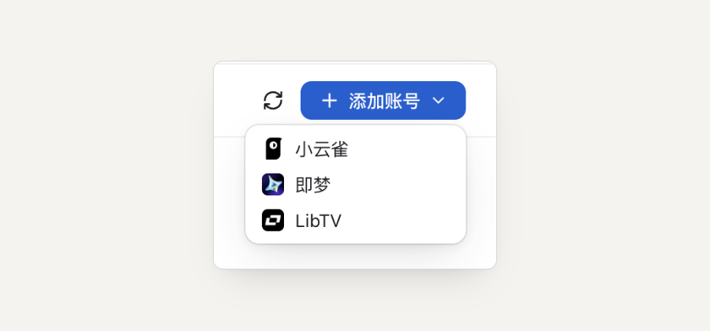

# Nodri vs. using Jimeng and Xiaoyunque websites directly

[简体中文](./zh-CN/nodri-vs-provider-websites.md) · [Nodri overview](../README.md)

Applies to Nodri v0.1.1 · Documentation checked: 2026-10-19

Nodri provides a local canvas for organizing AI image and video work across connected accounts. It keeps references, prompts, storyboards, and clips together. Generation still runs through the selected provider, such as Jimeng (即梦) or Xiaoyunque (小云雀), using that account's access and credits.

## What changes in the workflow?

| Task | With Nodri | Using a provider website directly |
| --- | --- | --- |
| Organize a project | Arrange imported references and generated results on a local canvas. | Use that website's workspace and your own file organization. |
| Reuse a reference across platforms | Connect a node or select it with `@`, if the target model accepts the input. | Move or upload the material between the services yourself. |
| Choose an account | Add accounts once, then choose the active account from the toolbar. | Use each website's account controls. |
| Choose generation settings | Choose a model and available parameters in a node. | Use the platform's own interface and exposed features. |
| Store canvas results | Results are downloaded into the local project. | Manage downloads and storage using the website's workflow. |
| Pay for generation | Each provider account keeps its own credits and rules. | Each provider account keeps its own credits and rules. |

Nodri exposes the capabilities in its [supported providers and models](./supported-models.md). Do not assume it includes every feature or model offered on a provider's website.

## Example: keep two revisions of one shot together

Import a character image and a room image. Create an image node, connect the references or select them through `@`, and generate a storyboard. Reference the chosen image in a video node. Select the account in the toolbar, then the model and settings in the node before submission.

To try another provider, switch the active account, check the next node's model and input requirements, and submit the next version. Keep the references and resulting clips side by side. Submitted tasks retain their original account.

See [the Jimeng and Xiaoyunque walkthrough](./jimeng-xiaoyunque-workflow.md) for the steps.

*Actual app screenshot showing the Add Account menu.*

## Which workflow fits?

Nodri is useful when a project reuses characters and scenes across many shots or provider accounts. For a single generation, or a feature available only in a platform's own interface, using that website directly may involve fewer steps.

The canvas does not automatically execute every connected node or edit clips into a finished film. References guide generation without guaranteeing character consistency.

Local storage does not mean offline inference or no uploads: generation requires an online provider and usable account, and needed references are sent to that provider. Nodri is an independent tool, not an official client of the named platforms; their names do not imply partnership or endorsement.

[Download Nodri](https://github.com/imaoda/nodri-canvas/releases/latest) · [Share feedback](https://github.com/imaoda/nodri-canvas/issues)
