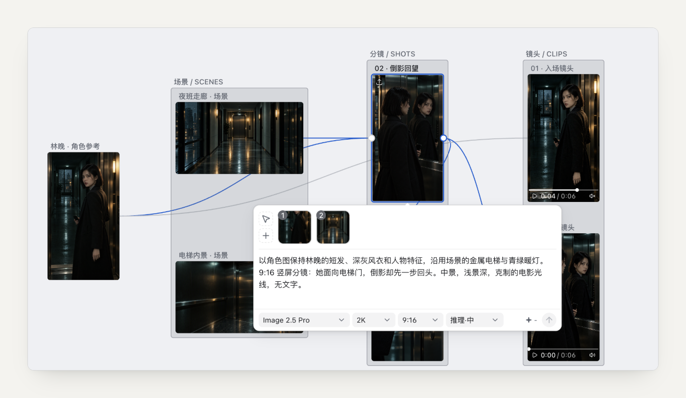

# Seedance 图生视频工作流：从角色参考到多个镜头

[首页](../../README.zh-CN.md) · [English](../seedance-image-to-video.md)

Nodri 可以把角色图、场景图、分镜图和 Seedance 视频结果放在同一画布。给视频节点连线参考素材，或在生成输入框中用 `@` 选择，再选择当前生成账号和 Seedance 模型。多个镜头分别创建视频节点、逐个提交。

适用 **Nodri v0.1.1**，核对日期 **2026-10-19**。版本范围见[平台与模型支持表](supported-models.md)。

## 准备角色与场景

1. 新建项目，在「设置 → 账号管理 → 添加账号」选择即梦或小云雀，在独立窗口登录，再选为当前生成账号。
2. 拖入角色图与场景图，导入文件会复制到本地项目。
3. 让角色外貌、服装和场景光线清晰可辨，先用少量相关素材。

*真实应用截图，使用导入的演示素材搭建。*

## 先定分镜，再描述运动

需要先确定构图时，新建图像节点，引用角色图与场景图，选择可用图像模型生成静帧。检查结果后，再将满意的分镜用于视频。

分镜提示词示例：

> 使用所选角色图的外貌和服装，采用场景图的咖啡馆环境。竖屏中景，人物站在雨天的玻璃窗旁，手持红色信封。傍晚柔光，手部清晰，不出现文字。

新建视频节点，连线满意的分镜，或从 `@` 菜单中选择。检查当前生成账号，选择可用 Seedance 模型，确认比例、时长、分辨率后提交。

视频提示词示例：

> 参考图中的人物和环境。人物缓慢打开红色信封，停顿，再看向咖啡馆门口。镜头轻微推进，动作克制，保持一个连续镜头。

这里的“参考图”须通过连线或 `@` 真正选中；仅在文字里输入文件名不会附加素材。

## 扩展成三个镜头

每个镜头单独创建视频节点，分别检查并提交：

| 镜头 | 参考 | 提示重点 |
| --- | --- | --- |
| 01 环境 | 角色图、咖啡馆图 | 全景，人物走进咖啡馆 |
| 02 揭示 | 已确认的信封分镜 | 中景，打开信封 |
| 03 反应 | 角色图、咖啡馆图 | 近景，看向门口 |

完成的结果会下载到项目，可继续引用。把输入素材放在对应结果旁，方便单独调整一个镜头。继续制作前，人工检查人物细节、动作与镜头衔接。

## 限制与下一步

参考图用于引导生成，不保证角色一致性。参数和参考数量限制取决于模型与平台。生成会把所选参考传至在线平台，需要账号、积分与服务可用；素材保存在本地不代表离线生成。

此流程得到独立镜头片段，最终成片仍需在视频剪辑软件中组装。

下一步：[整理 AI 短剧素材](short-drama-assets.md)，或查看[即梦与小云雀工作流](jimeng-xiaoyunque-workflow.md)。
